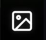

# Dokončenie spracovania

Akonáhle program Chloros dokončí spracovanie, je čas skontrolovať výsledky, overiť kvalitu výstupu a pripraviť spracované obrázky na použitie vo vašom pracovnom postupe. Táto stránka vás prevedie záverečnými krokmi a ďalšími úkonmi.

## Indikácia dokončenia spracovania

Po úspešnom dokončení spracovania sa zobrazia viaceré indikátory:

* ✅ **Indikátor priebehu**: Dosiahne 100 % dokončenia
* ✅ **Log ladiaceho režimu**: Zobrazuje záverečné riadky `[RUN-SUMMARY]` s počtami (obrázky, skupiny kamier, ciele, kalibrované obrázky, zapísané súbory)
* ✅ **Tlačidlo Štart**: Opäť sa aktivuje (pripravené na ďalšie spustenie spracovania)
* ✅ **Výstupné súbory**: Všetky spracované snímky sú uložené vo výstupnej štruktúre projektu (nižšie)


**Cyklus, pri ktorom sa nezapíšu žiadne snímky, sa považuje za neúspešný.** Ak ste požiadali o obrazové produkty a beh nezaznamenal žiadny, Chloros to nahlási ako zlyhanie — `[RUN-SUMMARY]` v názve protokolu naznačuje pravdepodobnú príčinu (nebolo importované nič, nebol detekovaný žiadny cieľ alebo boli všetky požadované produkty preskočené ako nepoužiteľné). Ekvivalent v CLI ukončí beh s nenulovým kódom. Úmyselné spustenie iba s metadátami (všetky exportované produkty vypnuté, žiadne indexy) sa stále považuje za úspešné. Pozrite si [Referenčnú príručku k CLI](../reference/cli-reference.md#a-run-that-writes-no-images-fails).


***

## Vyhľadanie spracovaných snímok

### Otvorenie výstupného priečinka

1. Kliknite na ikonu **Hlavné menu** 
(vľavo hore)
2. Vyberte **„Otvoriť priečinok projektu“**

3. Otvorí sa vám prehliadač súborov v adresári projektu
4. Vyhľadajte svoj projekt podľa názvu

### Výstupná štruktúra

Výstupy sú uložené **v zložke projektu, zoskupené podľa fotoaparátu a následne podľa formátu súboru**:

```
<project>/
└── LATT-M3M-L41-F550/                  # one folder per camera
    ├── tiff16/
    │   ├── Reflectance_Calibrated_Images/
    │   ├── Debayered_Images/
    │   ├── Preview_Images/
    │   └── NDVI_Index_Images/           # one folder per selected index
    └── tiff32/
        └── Radiance_Images/             # float32 radiance always lands here
```

* **Zložka fotoaparátu**: `LATT-<sensor>-<lens>-F<filter>` pre LATTICE (zodpovedá EXIF záznamu `Model`), `<model>_<filter>` pre Survey3 (napr. `Survey3N_RGN`). Dve kamery, ktoré majú spoločný snímač a filter, ale líšia sa objektívom, majú oddelené stromy — líšia sa vinetáciou, zorným poľom a skreslením.
* **Formát zložky**: riadi sa nastavením formátu exportu — `tiff16`, `tiff8`, `png8`, `jpg8`, alebo `tiff32` pre formát TIFF (32-bitový, v percentách). Radiance má vždy typ float32 a vždy sa nachádza pod `tiff32`.
* **Zložky produktov**:
  * `Reflectance_Calibrated_Images/` — kalibrovaná odrazivosť
  * `Debayered_Images/` — lineárne odstránenie bayesovského efektu (LATTICE): odstránený tmavý posun a demosaic, bez vyrovnávacieho poľa ani oddeľovania kanálov, v pôvodnej orientácii senzora
  * `Preview_Images/` — náhľad na displeji (LATTICE)
  * `Radiance_Images/` — spektrálna žiarivosť typu float32, W/m²/sr/nm (LATTICE multispektrálne)
  * `Vignette_Corrected_Images/` **alebo** `Sensor_Response_Images/` — nekalibrovaná náhradná verzia pre snímky bez referenčnej odrazivosti; na jedno spustenie existuje presne jeden z týchto dvoch súborov, vybraný nastavením korekcie vinetácie
  * `<INDEX>_Index_Images/` — jeden priečinok na každý vybraný index (napr. `NDVI_Index_Images`)
* **`clamp_masks/`** (novinka vo verzii 1.3.0, iba pre multispektrálne kamery LATTICE M3C): objavuje sa v priečinku formátu vedľa priečinkov produktov, ak dekompozícia pásiem orezala záporné hodnoty na nulu v produkte s jasom alebo odrazivosťou. Obsahuje jednu masku na pixel pre každý dotknutý produkt, napr. `tiff16/clamp_masks/Reflectance_Calibrated_Images/<name>_clampmask.tif`. Masky sa nikdy nenachádzajú vo vnútri zložky s produktom, takže zložku s produktom je možné odovzdať fotogrametrickému softvéru tak, ako je. Pozri [Masky obmedzenia](../output-image-formats.md#clamp-masks).


**Každý exportovaný produkt si zachováva názov zdrojového súboru.**Export radiancie produktu `capture_..._raw.tif` sa stále nazýva `capture_..._raw.tif` — len sa nachádza v zložke `tiff32/Radiance_Images/`.**Produkt identifikuje zložka, nie názov súboru**, takže vyhľadávanie súboru `*radiance*.tif` nič nenájde; namiesto toho vyhľadávajte podľa zložky.


<!-- SCREENSHOT-NEEDED: Windows Explorer open on a processed project folder showing the tree: a LATT-M3C multispectral camera folder expanded with tiff16 (Reflectance_Calibrated_Images, Debayered_Images, Preview_Images, NDVI_Index_Images, clamp_masks) and tiff32 (Radiance_Images, clamp_masks) subfolders visible -->


### Koľko súborov by malo byť?

Nepočítajte podľa vzorca — počet výstupov závisí od toho, ktoré produkty boli aktivované a ktoré sa vzťahujú na jednotlivé kamery (napr. kamery RGB nemajú žiarivosť/odrazivosť). Konečný počet je uvedený v protokole: posledný riadok `[RUN-SUMMARY]` uvádza presný počet súborov, ktoré boli zapísané, a riadky s poznámkami vysvetľujú všetko, čo bolo vynechané.

***

## Kontrola spracovaných obrázkov

### Rýchly náhľad v Průzkumníku súborov

**Vstavaný náhľad v systéme Windows:**

1. Prejdite do priečinka s produktom (napr. `tiff16/Reflectance_Calibrated_Images/`)
2. Vyberte obrazový súbor
3. Náhľad sa zobrazí v paneli náhľadov Průzkumníka Windows

4. Pomocou klávesov so šípkami prechádzajte medzi obrázkami

### Náhľad v externých prehliadačoch obrázkov

**Odporúčané prehliadače:*** **QGIS** – bezplatný GIS softvér (najlepší pre georeferencovanú multispektrálnu analýzu)
* **IrfanView** – rýchly a nenáročný prehliadač obrázkov (podporuje formát TIFF)
* **Adobe Photoshop** – profesionálna úprava obrázkov (podpora formátu TIFF)
* **GIMP** – bezplatná alternatíva k programu Photoshop
* **Windows Photos** – základné prezeranie (nemusí podporovať 16-bitový formát TIFF)

### Náhľad v prehliadači obrázkov Chloros


Na pokročilú vizualizáciu použite integrovaný prehliadač obrázkov Chloros:

1. Kliknite na miniatúru obrázku v prehliadači súborov
2. Obrázok sa otvorí v hlavnej oblasti náhľadu
3. Kliknite na kartu **Prehliadač obrázkov** 
v ľavom bočnom paneli
4. Na interaktívnu analýzu použite [Index/LUT Sandbox](../image-viewer-gui/index-lut-sandbox.md)

Podrobné pokyny nájdete v [Prehliadači obrázkov](../image-viewer-gui/opening-an-image-full-screen.md).

***

## Čítanie hodnôt odrazivosti pixelov (GIS / Pix4D / Skripty)

Odrazivosť je uložená ako celé číslo DN a **hodnota DN, ktorá zodpovedá ρ = 1,0, závisí od zdrojovej kamery**:

| Zdroj          | ρ = 1,0 je | Ako zistiť                                        |
| --------------- | ---------- | -------------------------------------------------- |
| LATTICE (M3C/M3M) | **32768** (rezerva až do ρ 2,0) | Súbor je označený značkou XMP `Chloros:PixelScale=32768` |
| Survey3          | **65535** (obmedzené na ρ 1,0)     | Žiadna značka `Chloros:PixelScale` — táto absencia je signálom (produkty Survey3 obsahujú iné značky spracovania typu `Chloros:*`) |

**Prečítajte značku `Chloros:PixelScale` a vydelte ňou** namiesto toho, aby ste predpokladali paušálnu hodnotu 65535 — vydelením odrazivosti LATTICE číslom 65535 sa každá hodnota bez upozornenia zníži na polovicu. Súbor odrazivosti z verzie pred 1.3.0, ktorý bol zapísaný ako 8-bitový, bol orezaný, nie preškálovaný, a nemá značku mierky: namiesto delenia ho znovu exportujte v 16-bitovom alebo 32-bitovom formáte. Podrobnosti nájdete v časti [Formáty výstupných obrázkov](../output-image-formats.md).***

## Metadáta prenášané do exportov

Každý produkt zachováva **blok GPS**zo zdrojového záznamu a jeho**podblok EXIF**, takže
export obsahuje súbory `FocalLength`, `FNumber`, `ExposureTime`, `ISO`, `DateTimeOriginal` a
`CameraSerialNumber`, ako aj georeferenciu.


**Ak sa ortomozaika vytvorí v absurdnom meradle, najskôr skontrolujte `FocalLength`.**
Pix4D vypočíta vzdialenosť vzorky na zemi na základe ohniskovej vzdialenosti a nadmorskej výšky. Bez tejto značky
sa vráti k úplne nesprávnemu meradlu – pri jednom meranom lete so 49 zábermi bol pomarančový háj s rozmermi 411 m × 160 m
pomarančový háj bol rekonštruovaný ako 47,8 km × 13 km, čo viedlo k vytvoreniu 455-megapixelovej ortomapy prevažne
prázdneho priestoru. Pomalé vytváranie dlaždíc a neočakávane veľký súbor sú príznakmi tohto problému, nie samostatnými
problémami.

```bash
exiftool -FocalLength -GPSLatitude "YourProject/.../some_export.tif"
```


Nie *všetky* tagy sa kopírujú. Štrukturálne tagy IFD0 sa zámerne vynechávajú (ich kopírovanie
poškodzuje výstup LATTICE) a súbory `ExifImageWidth` / `ExifImageHeight` sú vylúčené,
pretože opisujú pôvodný záznam — export, ktorého veľkosť bola zmenená, by inak
uvádzal rozmery, ktoré sú v rozpore s jeho vlastným rastrovým obrazom.

Chloros tiež zapisuje vlastné XMP značky typu `Chloros:*`, ktoré opisujú, čo sa s každým produktom vykonalo
(napríklad `Chloros:ProcessingLevel`, `Chloros:CalibrationApplied`,
`Chloros:VignetteCorrected`). Od verzie 1.3.0 ich produkty Survey3 obsahujú v každom režime spracovania
režime, indexové produkty opisujú samotný index (`Chloros:ProcessingLevel=index`,
vzorec a to, či bol vypočítaný na základe odrazivosti alebo žiarivosti) namiesto opakovania
značiek zdrojových surových dát, a produkty v priečinkoch s názvami dlhšími ako 260 znakov si zachovávajú svoje metadáta
tiež. Pozrite si [Formáty výstupných obrázkov](../output-image-formats.md#index-products).

***

## Kontrola ladiaceho protokolu

### Kontrola varovaní alebo chýb

1. Otvorte kartu **Log ladenia** 

2. Prejdite správami
3. Hľadajte žlté varovania alebo červené chyby
4. Prečítajte si riadky `[RUN-SUMMARY]` a prípadné rady
5. Kontaktujte podporu MAPIR, ak potrebujete pomoc

### Uloženie protokolu

Ak chcete uchovať záznam o spracovaní alebo ho poslať podpore MAPIR:

1. Kliknite na tlačidlo **„Kopírovať“**alebo**„Stiahnuť“**

2. Uložte ako textový súbor do priečinka projektu
3. Priložte k dokumentácii projektu
4. V prípade problémov ho pošlite podpore MAPIR Ak chcete nahlásiť problém priamo spoločnosti MAPIR, použite ikonu chyby (**Nahlásiť chybu**) v hornej časti karty Debug Log — pozrite si [Nahlásenie chyby z karty protokolu](monitoring-the-processing.md#reporting-a-bug-from-the-log-tab).***

## Bežné problémy s výstupom a ich riešenia

### Problém: Chýbajúce výstupné súbory

**Možné príčiny:**

* Produkt sa na danú kameru nevzťahuje (napr. radiancia/reflektancia pre RGB kamery — uvádza sa to v protokole)
* Chýbala povinná referencia (napr. odrazivosť bez cieľa a bez `.daq` dopadu lúčov smerom nadol)
* Zaškrtávacie políčko pre export produktu bolo v nastaveniach projektu deaktivované
* Počas exportu došlo k vyčerpaniu miesta na disku

**Riešenia:**

1. Skontrolujte rady `[RUN-SUMMARY]` a riadky `[EXPORT-CHECK]` v lógovom súbore ladenia — vysvetľujú vynechania pre jednotlivé kamery
2. Skontrolujte zaškrtávacie políčka pre export produktov v [Nastaveniach projektu](adjusting-project-settings.md)
3. Skontrolujte, či bolo k dispozícii dostatočné miesto na disku
4. Po odstránení príčiny spustite spracovanie znovu

### Problém: Tmavé alebo svetlé okraje (vignettovanie je stále viditeľné)

**Možné príčiny:**

* Korekcia vinetácie je vypnutá
* Kamera/objektív nie je v databáze profilov Chloros

* Extrémna vinetácia presahujúca možnosti korekcie

**Riešenia:**

1. Overte, či bola v Nastaveniach projektu zapnutá korekcia vinetácie
2. Skontrolujte, či bol správne rozpoznaný model kamery
3. Ak vinetácia pretrváva, kontaktujte podporu MAPIR


### Problém: Nesprávne farby alebo hodnoty

**Možné príčiny:**

* Neboli zistené kalibračné ciele
* Bol vybraný nesprávny model kalibračného cieľa
* Kalibrácia odrazivosti je vypnutá
* Nízka kvalita snímok cieľov

**Riešenia:**

1. Overte, či bola zapnutá kalibrácia odrazivosti
2. Skontrolujte správy „Cieľ nájdený“ v ladiacom protokole
3. Skontrolujte kvalitu snímok cieľov
4. Spustite spracovanie znovu so správne označenými cieľmi

### Problém: Hodnoty NDVI sa zdajú nesprávne

**Očakávané rozsahy hodnôt NDVI:*** **Voda, skaly, pôda**: -0,1 až 0,2
* **Riedka/nezdravá vegetácia**: 0,2 až 0,4
* **Stredná vegetácia**: 0,4 až 0,6
* **Zdravá, hustá vegetácia**: 0,6 až 0,9**Ak sú hodnoty mimo týchto rozsahov:**

1. Overte, či bola použitá kalibrácia odrazivosti
2. Overte, či bol zahrnutý protokol svetelného senzora
3. Skontrolujte, či boli detekované kalibračné ciele
4. Uistite sa, že bol detekovaný správny model kamery
5. Skontrolujte načasovanie a podmienky snímania cieľových snímok
6. Ak indexy vypočítavate sami zo súborov odrazivosti, uistite sa, že ste hodnotu vydelili hodnotou `Chloros:PixelScale` uvedenou v súbore (pozri vyššie)

***

## Používanie spracovaných snímok

### Pre fotogrametriu / tvorbu ortomozaiky

**Odporúčaný pracovný postup:**

1.**Importujte kalibrované snímky odrazivosti** do fotogrametrického softvéru:
   * Pix4Dmapper
   * Agisoft Metashape
   * DroneDeploy
   * WebODM
2. **Zachovajte metadáta EXIF**: Uistite sa, že sú zachované údaje GPS pre geotagovanie
3. **Kalibrované pracovné postupy**: Používajte snímky odrazivosti pre vedeckú presnosť — odrazivosť LATTICE obsahuje kalibračné značky XMP, ktoré Pix4D číta
4. **Spracujte indexové mozaiky**: Vytvorte ortomozaiky NDVI z jednotlivých indexových snímok
5. **Exportujte georeferencované súbory GeoTIFF**: Na použitie v aplikáciách GIS

### Pre analýzu v GIS

**Odporúčaný pracovný postup:**

1.**Načítajte do QGIS, ArcGIS alebo podobného programu**

2.**Použite 16-bitové TIFF** snímky odrazivosti na multispektrálnu analýzu (vydelite hodnotou `Chloros:PixelScale` uvedenou v súbore)
3. **Použite indexové snímky** (NDVI, NDRE) ako pripravené vrstvy vegetácie
4. **Rastrový kalkulátor**: Kombinujte pásma pre vlastnú analýzu
5. **Export**: Vytvorte klasifikačné mapy, detekciu zmien, mapy zdravotného stavu vegetácie

### Pre priamu analýzu / vykazovanie

**Odporúčaný postup:**

1.**Použite indexové snímky s farbami LUT** pre vizuálne správy
2. **Extrahujte štatistiky**: Priemerná hodnota NDVI na pole/parcelu
3. **Časové rady**: Porovnávajte indexy medzi viacerými sedeniami
4. **Vytvorte správy**: Zahrňte mapy, štatistiky a vizualizácie***

## Archivácia a zálohovanie

### Odporúčaná stratégia zálohovania

**Čo uložiť:*** ✅ **Pôvodné snímky vo formáte RAW/JPG alebo surové záznamy LATTICE** – archivujte na samostatnom disku/v cloude; surové dáta sú zdrojom spracovateľského reťazca a všetko ostatné sa z nich dá znovu vygenerovať
* ✅ **Súbory zo svetelných senzorov `.daq` / `.csv`** – potrebné na neskoršie opätovné odvodenie odrazivosti
* ✅ **Spracované výstupy** – uchovajte kalibrované snímky a indexy
* ✅ **Zložka projektu** (`project.json` a súvisiace súbory) – Obsahuje všetky nastavenia pre prípadné opätovné spracovanie
* ✅ **Log ladiaceho procesu** – Dokumentuje podrobnosti spracovania
* ✅ **Obrázky kalibračných terčov** – Na overenie a opätovné spracovanie**Odporúčania pre ukladanie:*** **Okamžitá záloha**: Externý pevný disk
* **Dlhodobý archív**: Úložisko v cloude (Google Drive, Dropbox atď.)
* **Kritické údaje**: Uložte 2–3 kópie na rôznych miestach***

## Ďalšie spracovania

### Opätovné použitie nastavení projektu

Ak budete v budúcnosti spracovávať podobné súbory údajov:

1. **Uložte šablónu projektu** (ak ste tak ešte neurobili)
2. **Vytvorte nový projekt** pomocou uloženej šablóny
3. **Importujte nové obrázky**

4.**Spracujte**s identickými nastaveniami pre zachovanie konzistencie

### Hromadné spracovanie viacerých sedení

V prípade viacerých sedení/datasetov:**Možnosť 1: Grafické rozhranie (GUI) – viaceré projekty**

* Vytvorte samostatný projekt pre každé sedenie
* Použite konzistentné nastavenia šablóny
* Spracúvajte po jednom

**Možnosť 2: Chloros CLI (len Chloros+)**

* Automatizujte hromadné spracovanie
* Spracúvajte viacero zložiek pomocou skriptov
* Pozrite si [Dokumentáciu CLI](../CLI.md) a [Referenciu CLI](../reference/cli-reference.md)

**Možnosť 3: Python SDK (len Chloros+)**

* Programové ovládanie
* Integrácia s analytickými postupmi
* Pozrite si [Dokumentáciu k API](../api-python-sdk.md) a [Referenčnú príručku k SDK](../reference/sdk-reference.md)

***

## Riešenie problémov pri následnom spracovaní

### Opätovné spracovanie s odlišnými nastaveniami

Ak výsledky nie sú uspokojivé:

1. Zachovajte pôvodné obrázky (nikdy ich nemazajte)
2. Otvorte ten istý projekt v Chloros
3. Upravte nastavenia v paneli Nastavenia projektu
4. Spracujte znovu — výstupy sa uložia do rovnakých produktových zložiek, takže súbory s rovnakým názvom z predchádzajúceho spustenia budú nahradené

### Spracovanie podmnožiny obrázkov

Ak chcete spracovať len konkrétne obrázky:

1. Vytvorte nový projekt
2. Importujte len obrázky, ktoré potrebujú opätovné spracovanie
3. Použite rovnakú šablónu nastavení
4. Spracujte menšiu sadu údajov

### Získanie pomoci

Ak narazíte na problémy:

* 📧 **E-mail**: info@mapir.camera (priložte ladiaci protokol)
* 🌐 **Podpora**: [https://www.mapir.camera/community/contact](https://www.mapir.camera/community/contact)
* 📚 **Často kladené otázky**: [Často kladené otázky](../faq.md)
* 📖 **Dokumentácia**: [Príručka k programu Chloros](../)

***

## Zhrnutie: Kompletný pracovný postup

Teraz ste dokončili celý pracovný postup spracovania v Chloros:

1. ✅ **Vytvorili ste projekt** – pozrite si [Projekty](../projects.md)
2. ✅ **Pridali ste súbory** – pozrite si [Pridávanie súborov](adding-files-to-a-project.md)
3. ✅ **Upravili ste nastavenia** – pozrite si [Úprava nastavení projektu](adjusting-project-settings.md)
4. ✅ **Označili ste ciele** – pozrite si [Výber cieľových obrázkov](choosing-target-images.md)
5. ✅ **Spustilo sa spracovanie** – pozri [Spustenie spracovania](starting-the-processing.md)
6. ✅ **Sledoval sa priebeh** – pozri [Sledovanie priebehu spracovania](monitoring-the-processing.md)
7. ✅ **Skontrolované výsledky** – Táto stránka**Vaše kalibrované multispektrálne snímky s korekciou odrazivosti sú pripravené na analýzu!**

***

## Ďalšie zdroje

### Pokročilé funkcie

* [**Prehliadač snímok**](../image-viewer-gui/opening-an-image-full-screen.md) – Interaktívna vizualizácia a analýza
* [**Index/LUT Sandbox**](../image-viewer-gui/index-lut-sandbox.md) – Testovanie vlastných indexov
* [**Vzorce multispektrálnych indexov**](../project-settings/multispectral-index-formulas.md) – Kompletný referenčný zoznam indexov

### Automatizácia a integrácia

* [**Dokumentácia CLI**](../CLI.md) – Hromadné spracovanie z príkazového riadku
* [**Python SDK**](../api-python-sdk.md) – Programová automatizácia
* [**Funkcie Chloros+**](../#chloros) – Pokročilé možnosti spracovania

### Podpora a vzdelávanie

* [**Často kladené otázky**](../faq.md) – Odpovede na bežné otázky
* [**Kalibračné terče**](../calibration-targets.md) – Vysvetlenie kalibrácie odrazivosti
* [**Podporované kamery**](../supported-cameras.md) – Kompatibilný hardvér
